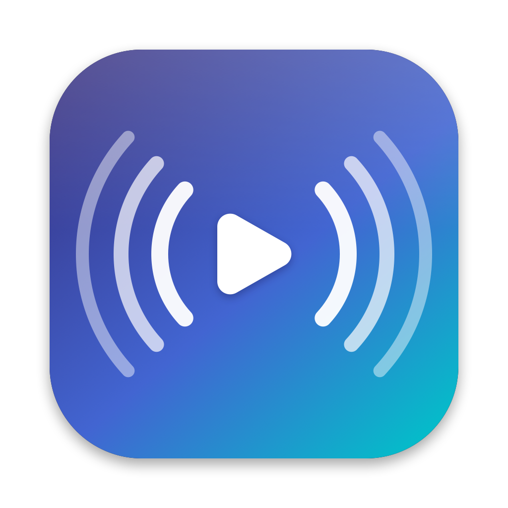

<p align="center"></p>

# OpenPlaySync

A small macOS menu-bar app that plays your Mac's audio on several sound devices at once, such as the built-in speakers plus a Bluetooth speaker, and keeps them in time.

macOS's own Multi-Output Device can't correct for Bluetooth latency, so the speakers drift apart and the volume keys stop working. OpenPlaySync fixes both.

## Features

- **Pick devices with checkboxes.** Every sound device on the Mac is listed and updates live as devices connect or disconnect. Tick the ones you want to play on.
- **Delay per device.** Delay the faster devices (usually wired or built-in) by 0–600 ms so they line up with slower Bluetooth ones. Use the ±1 / ±10 ms buttons for fine-tuning.
- **Test clicks.** Plays a burst of clicks through every selected device so you can hear which one is early.
- **Volume per device.** Uses the device's own volume control when it has one, and adjusts the level in the app when it doesn't.
- **Volume keys still work.** The keyboard and menu-bar volume act as a master volume over every selected device.
- **Settings are saved.** Selected devices, delays and volumes are remembered between launches.

## Requirements

- macOS 14.2 or later (uses Core Audio process taps)
- Xcode Command Line Tools (`xcode-select --install`)

## Build and install

```bash
git clone https://github.com/CouraLabs/OpenPlaySync.git
cd OpenPlaySync
./scripts/build.sh --install
```

This builds `build/OpenPlaySync.app`, copies it to `~/Applications`, and launches it. The first time, macOS asks for permission to capture system audio. Allow it under **System Settings → Privacy & Security → Screen & System Audio Recording**.

## Usage

1. Click the speaker icon in the menu bar.
2. Tick the devices you want to play on.
3. Press **Play test clicks** and raise the delay on whichever device plays first until the clicks sound like one. Bluetooth devices usually stay at 0 ms, and built-in speakers usually need about 150–250 ms.

## How it works

1. A Core Audio **process tap** captures all system audio, except OpenPlaySync's own, and mutes the normal output so nothing plays twice.
2. A **private aggregate device** is built from the devices you selected, with the tap as its input. Drift compensation keeps the devices' clocks aligned.
3. One real-time IO callback writes the captured audio into a ring buffer. Each device reads from that buffer at its own delay and gain.

When OpenPlaySync stops or quits, the tap and aggregate are removed and audio goes back to normal.

## Debugging

Render the menu to an image without opening it:

```bash
~/Applications/OpenPlaySync.app/Contents/MacOS/OpenPlaySync --snapshot ~/Desktop/menu.png
```

Regenerate the icon after editing `scripts/make-icon.swift`:

```bash
swift scripts/make-icon.swift
```

## License

MIT. See [LICENSE](LICENSE).
